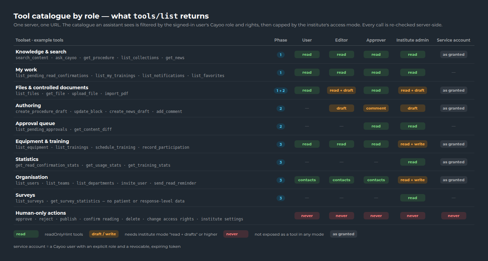

# Tool catalogue

Planned tools, by toolset. Names can still change before release.

Your assistant only lists the tools that your Cayoo role, your institute's access mode and the enabled toolsets allow. Every call is checked again on the server.

| Toolset | Tools | Who | Version |
|---|---|---|---|
| Knowledge & search | `search_content`, `ask_cayoo`, `get_procedure`, `list_collections`, `get_news` | everyone, read | 1 |
| My work | `list_pending_read_confirmations`, `list_my_trainings`, `list_notifications`, `list_favorites` | everyone, read | 1 |
| Files & controlled documents | `list_files`, `get_file`; later `upload_file`, `import_pdf` | read for everyone; upload and import for editors and administrators | 1, 2 |
| Authoring | `create_procedure_draft`, `update_block`, `create_news_draft`, `add_comment` | editors and administrators (drafts); approvers (comments) | 2 |
| Approval queue | `list_pending_approvals`, `get_content_diff` | approvers and administrators, read | 2 |
| Equipment & training | `list_equipment`, `list_trainings`, `schedule_training`, `record_participation` | read for everyone; write for administrators | 3 |
| Statistics | `get_read_confirmation_stats`, `get_usage_stats`, `get_training_stats` | administrators, read | 3 |
| Organisation | `list_users`, `list_teams`, `list_departments`, `invite_user`, `send_read_reminder` | contacts for everyone; the rest for administrators | 3 |
| Surveys | `list_surveys`, `get_survey_statistics` | aggregate results only | 3 |

## Never available

No tool exists, in any access mode, for:

- approving, rejecting or publishing content
- confirming that you have read something
- deleting content
- changing access rights or institute settings
- patient-level or response-level survey data
